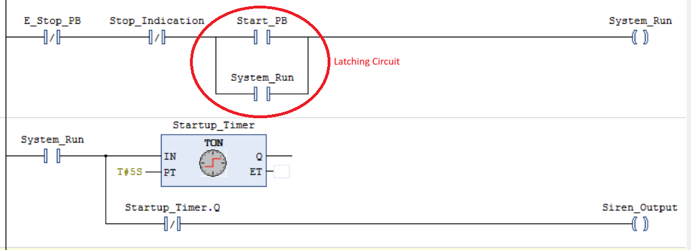
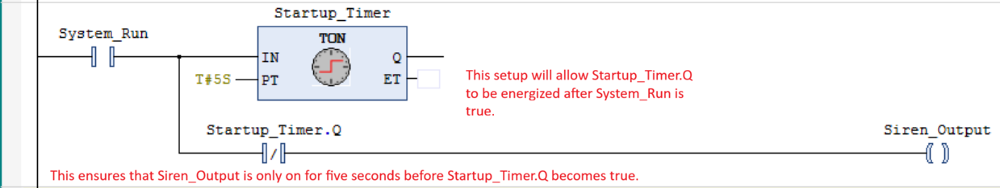
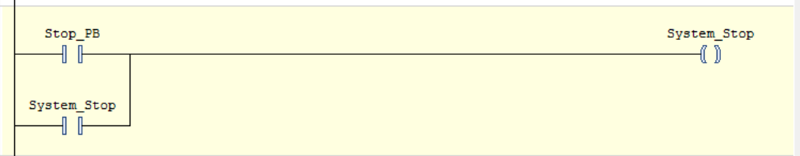
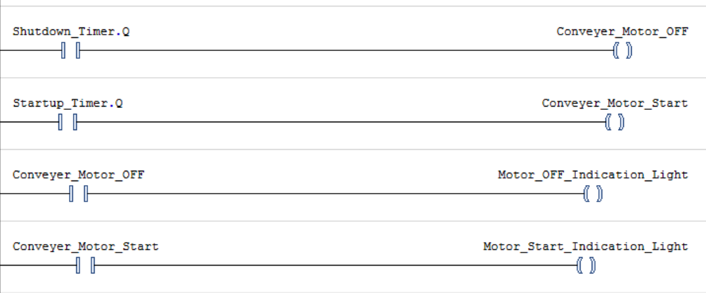
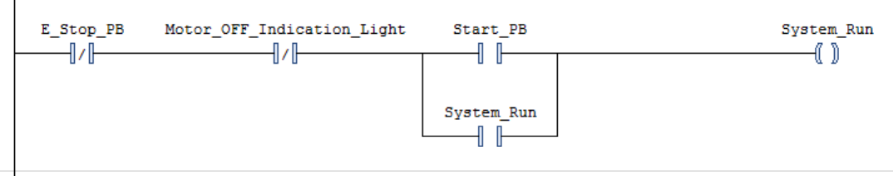
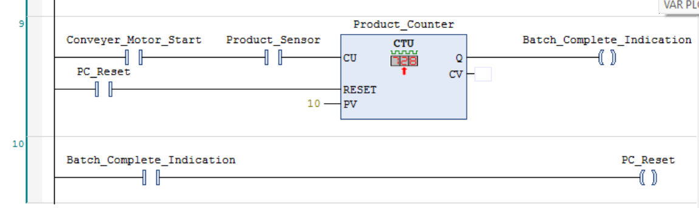

# Control Logic

## Conveyer Startup Sequence 

### Objective
My main objective is to create a startup sequence for my conveyor belt that warns nearby workers to step away before the conveyor motors start. I will do this using a specialized TON timer.

### Latching Circuit

The startup sequence activates a siren for five seconds before the conveyor belt starts. To accomplish this, I added an internal variable called System_Run to create a latching circuit with Start_PB.

- System_Run is used as the coil for the rung.
- A parallel branch with another System_Run contact creates the latching circuit.
- This allows the operator to release Start_PB without interrupting the startup request.

### Startup Timer and Siren

I connected Startup_Timer to System_Run, allowing the timer to begin counting toward its five-second preset when System_Run becomes TRUE.

- A normally closed Startup_Timer.Q contact controls Siren_Output during the warning delay.
- When the timer reaches its five-second preset, Startup_Timer.Q becomes TRUE, opening the normally closed contact and de-energizing Siren_Output.
- The siren logic must also ensure that the siren only activates when the startup sequence is active.

### Emergency-Stop Response

In case a fault happens during operation, I have implemented an emergency stop as a normally closed contact near the beginning of the conveyor control logic.

- When the emergency-stop condition is activated, the simulated motor command should be disabled immediately without waiting for the normal-stop timer.
- This simulation will not replace a actual emergency-stop system, and I will implement more features for it in the future.

## Conveyer Stop Latching Circuit 

Similar to the startup sequence, I have implemented a TON timer to allow staff to back away from the conveyer belt. Again, I used a Stop_PB and System_Stop to create a latching circuit. 

- System_Stop acts as the coil in this rung, once activated by Stop_PB it will create a latching circuit with System_Stop using a parallel contact. 

## Conveyer Stop Shutdown Process

After System_Stop is activated, it will activate both a TON timer set for 5 seconds and a negated contact which serves as a Shutdown_Timer.Q. 

- Once the five second timer has been reached, it will open the negated contact, deactivating the siren. 

- Shutdown_Timer.Q is now true, activating the coil Conveyer_Motor_Off, which is a hidden variable. 
- Once the Conveyer_Motor_Off is true, it will activate a indication light called Motor_OFF_Indication_Light. 
- Motor_OFF_Indication_Light is now true, opening the negated contact and shutting down the conveyer belt. 

## CTU and Sensors

My goal is to make a Product_Counter as a CTU to count the number of boxes which go through the conveyer belt using a array of simulated sensors called Product_Sensor. 

- Once Conveyer_Motor_Start is activated, it will activate the Product_Sensor. Once the sensor has been turned on, it will activate the CTU. 
- The CTU has a preset value of 10 boxes. Once this has been reached, it will activate the coil Batch_Complete_Indication. 

- To reset the Product_Counter, I made Batch_Complete_Indication as a contact. Once it is true, it will activate our PC_Reset, which will effectively set the CTU to 0. 
- After encountering several issues with CT-05 (see testing.md), I decided to remove the orginial rung used to reset the CTU, instead replacing it with a TON set for 3 seconds. 

More info about debugging logic in testing.md. 

