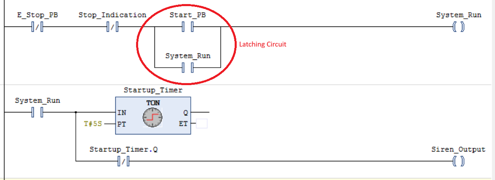
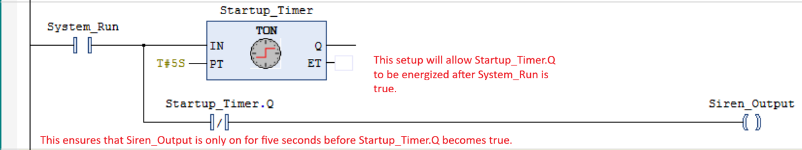

# Control Logic

## Conveyer Startup Sequence 

### Objective
My main objective is to create a startup sequence for my conveyor belt that warns nearby workers to step away before the conveyor motors start. I will do this using a specialized TON timer.

### Latching Circuit

The startup sequence activates a siren for five seconds before the conveyor belt starts. To accomplish this, I added an internal variable called System_Run to create a latching circuit with Start_PB.

- System_Run is used as the coil for the rung.
- A parallel branch with another System_Run contact creates the latching circuit.
- This allows the operator to release Start_PB without interrupting the startup request.

### Startup Timer and Siren

I connected Startup_Timer to System_Run, allowing the timer to begin counting toward its five-second preset when System_Run becomes TRUE.

- A normally closed Startup_Timer.Q contact controls Siren_Output during the warning delay.
- When the timer reaches its five-second preset, Startup_Timer.Q becomes TRUE, opening the normally closed contact and de-energizing Siren_Output.
- The siren logic must also ensure that the siren only activates when the startup sequence is active.

### Emergency-Stop Response

In case a fault happens during operation, I have implemented an emergency stop as a normally closed contact near the beginning of the conveyor control logic.

- When the emergency-stop condition is activated, the simulated motor command should be disabled immediately without waiting for the normal-stop timer.
- This simulation does not replace a real safety-rated emergency-stop system.
