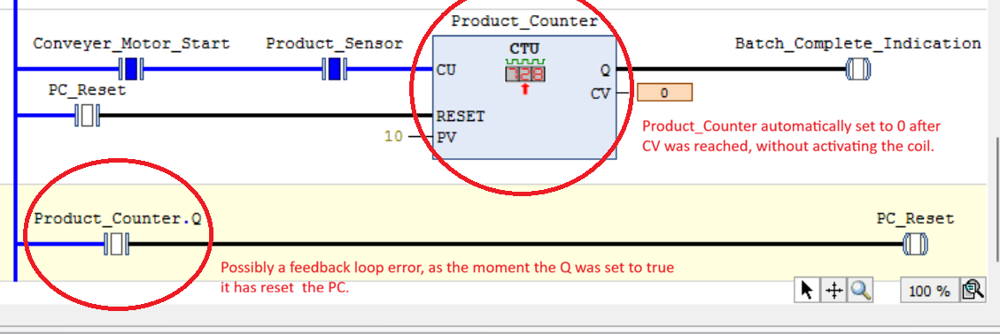
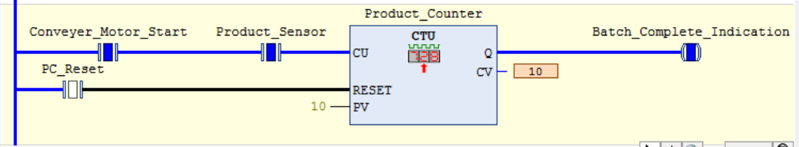
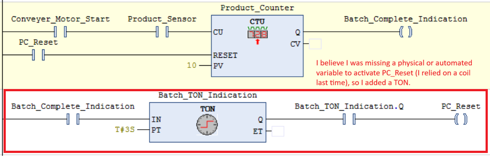

# Testing and Verification

## Test Environment

- **IDE:** CODESYS V3.5 SP22 Patch 2
- **Controller:** CODESYS Control Win V3 x64 simulation
- **Language:** Ladder Diagram (LD)

# Startup and Shutdown Sequence

## Startup Sequence

| Test ID | Test | Expected Result | Actual Result | Status |
|---|---|---|---|---|
| ST-01 | Press and release Start briefly. | Startup sequence remains active after the button is released. | Success | Tested |
| ST-02 | Observe the startup warning interval. | Siren remains active during the intended five-second interval. | Success | Tested |
| ST-03 | Observe timer completion. | Siren turns off and the motor command activates when all required conditions are satisfied. | Fail | Tested |
| ST-04 | Activate the simulated emergency-stop input during startup. | Motor command is disabled without waiting for the startup timer. | Success | Tested |

## Normal Stop Sequence

| Test ID | Test | Expected Result | Actual Result | Status |
|---|---|---|---|---|
| NS-01 | Press and release Stop briefly. | Normal-stop sequence continues after the button is released. | Success | Tested |
| NS-02 | Observe the stop warning interval. | Siren follows the intended warning behaviour during the delay. | Success | Tested |
| NS-03 | Observe stop-timer completion. | Motor command turns off after delay. | Success | Tested |
| NS-04 | Press Start while the stop sequence is active. | System follows the explicitly designed behaviour for this situation. | Fail | Tested |
| NS-05 | Activate the simulated emergency-stop input during the stop delay. | Motor command is disabled without waiting for the normal-stop timer. | Success | Tested |

## Issues and Troubleshooting

| Issue | Observed Behaviour | Investigation | Fix | Retest Result |
|---|---|---|---|---|
| Motor ON and OFF variables not responding | .Q should turn "True" for ON and OFF variables, however it did not.| Contacts READ variables, not CHANGE variables, so I added two new rungs so I can change the variables using a output and .q as a input. | Success |

## Testing Notes

Record actual observations, not assumed results.
Mark a test as Passed only after verifying the expected behaviour.
Record failures and retest after making changes.
Include screenshots when they provide useful evidence of the program's state.

- Startup sequence has ran into a problem regarding the indication lights. I have used .Q, so once the TON ends, .Q should be true. 
- The expressions tell us that they are false, disabling our motor indication lights. 

- Contacts should read variables, which means motor ON and OFF are being read as "False". I need to find a way to make them "True" so I decided to make two rungs to make a output for each so once it is read in the next rung it can be turned "True". 

- The problem has been solved, it was not a matter of incorrect logic but rather a common error found when running the simulation, as I have forgotten to "run" the simulated enviroment. 

# CTU and Sensors

## Product Counter

| Test ID | Test | Expected Result | Actual Result | Status |
|---|---|---|---|---|
| CT-01 | Activate the product sensor once. | Counter increments by one (CV increases by 1). | Complete | Tested |
| CT-02 | Keep the product sensor active. | Counter increments only once while the input remains TRUE. | Complete | Tested |
| CT-03 | Activate the product sensor multiple times. | Counter increments once for each rising edge of the sensor signal. | Complete | Tested |
| CT-04 | Reach the counter preset value of 10. | Counter output (Q) becomes TRUE when CV reaches PV. | | Not Tested |
| CT-05 | Activate the counter reset (PC_Reset). | Counter value (CV) returns to zero and Q becomes FALSE. | Debugged | Tested |
| CT-06 | Increment the counter after resetting. | Counter resumes counting from zero. | Complete | Tested |
| CT-07 | Observe the batch-complete indication. | Batch_Complete_Indication activates when the counter reaches its preset. | Complete | Tested |

- CT-05 required troubleshooting. The .Q CV output is set to 10, and it is expected that it will activate the Batch_Complete_Indication, however the CV instantaneously set back to 0. 

- I suspected that I had accidently created a feedback loop with the bottom rung, so I decided to delete the rung and see what happens. 

- My suspicons were proven, and it was indeed a problem with the bottom rung, so the CTU is working properly but the logic for my bottom rung is incorrect. 
- The issue was that the CTU resetted without ever activating the Batch_Complete_Indication, which can cause confusion and disorder inside the operations room. 
- I decided to reiterate my design and I decided to add a TON timer. It is preset so that every 3 seconds after the CV has been reached, it will automatically reset the PV. 

- Previously, I noticed that I was missing a variable to physically or automatically "activate" PC_Reset, and I was relying on a coil the whole time. 
- I added a TON preset for 3 seconds and linked PC_Reset as the coil, so the operators can both be notifyed and they do not have to be concerned about clicking a physical button to reset the CTU. This time, everything works accordingly. 
- The Batch_Complete_Indication can now be turned on and can be automatically turned off through PC_Reset, and the CTU can also automatically reset all after three seconds. 