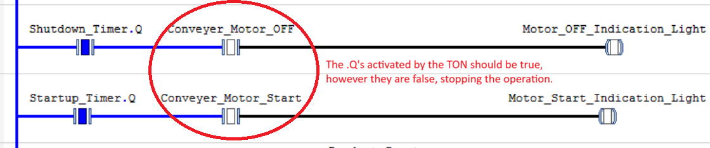
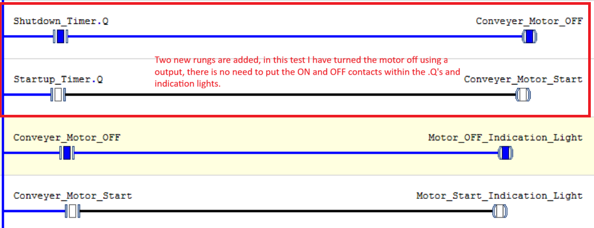

# Testing and Verification

## Test Environment

- **IDE:** CODESYS V3.5 SP22 Patch 2
- **Controller:** CODESYS Control Win V3 x64 simulation
- **Language:** Ladder Diagram (LD)

## 1. Startup Sequence

| Test ID | Test | Expected Result | Actual Result | Status |
|---|---|---|---|---|
| ST-01 | Press and release Start briefly. | Startup sequence remains active after the button is released. | Success | Tested |
| ST-02 | Observe the startup warning interval. | Siren remains active during the intended five-second interval. | Success | Tested |
| ST-03 | Observe timer completion. | Siren turns off and the motor command activates when all required conditions are satisfied. | Fail | Tested |
| ST-04 | Activate the simulated emergency-stop input during startup. | Motor command is disabled without waiting for the startup timer. | Success | Tested |

## 2. Normal Stop Sequence

| Test ID | Test | Expected Result | Actual Result | Status |
|---|---|---|---|---|
| NS-01 | Press and release Stop briefly. | Normal-stop sequence continues after the button is released. | Success | Tested |
| NS-02 | Observe the stop warning interval. | Siren follows the intended warning behaviour during the delay. | Success | Tested |
| NS-03 | Observe stop-timer completion. | Motor command turns off after delay. | Success | Tested |
| NS-04 | Press Start while the stop sequence is active. | System follows the explicitly designed behaviour for this situation. | Fail | Tested |
| NS-05 | Activate the simulated emergency-stop input during the stop delay. | Motor command is disabled without waiting for the normal-stop timer. | Success | Tested |

## 3. Issues and Troubleshooting

| Issue | Observed Behaviour | Investigation | Fix | Retest Result |
|---|---|---|---|---|
| Motor ON and OFF variables not responding | .Q should turn "True" for ON and OFF variables, however it did not.| Contacts READ variables, not CHANGE variables, so I added two new rungs so I can change the variables using a output and .q as a input. | Success |

## 4. Testing Notes

Record actual observations, not assumed results.
Mark a test as Passed only after verifying the expected behaviour.
Record failures and retest after making changes.
Include screenshots when they provide useful evidence of the program's state.

- Startup sequence has ran into a problem regarding the indication lights. I have used .Q, so once the TON ends, .Q should be true. 
- The expressions tell us that they are false, disabling our motor indication lights. 

- Contacts should read variables, which means motor ON and OFF are being read as "False". I need to find a way to make them "True" so I decided to make two rungs to make a output for each so once it is read in the next rung it can be turned "True". 

